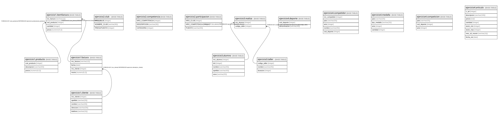

# facu

## Tables

| Name | Columns | Comment | Type |
| ---- | ------- | ------- | ---- |
| [ejercicio1.producto](ejercicio1.producto.md) | 3 |  | BASE TABLE |
| [ejercicio1.cliente](ejercicio1.cliente.md) | 5 |  | BASE TABLE |
| [ejercicio1.factura](ejercicio1.factura.md) | 4 |  | BASE TABLE |
| [ejercicio1.itemfactura](ejercicio1.itemfactura.md) | 4 |  | BASE TABLE |
| [ejercicio2.club](ejercicio2.club.md) | 3 |  | BASE TABLE |
| [ejercicio2.competencia](ejercicio2.competencia.md) | 3 |  | BASE TABLE |
| [ejercicio2.participacion](ejercicio2.participacion.md) | 3 |  | BASE TABLE |
| [ejercicio3.alumno](ejercicio3.alumno.md) | 5 |  | BASE TABLE |
| [ejercicio3.taller](ejercicio3.taller.md) | 3 |  | BASE TABLE |
| [ejercicio3.realiza](ejercicio3.realiza.md) | 2 |  | BASE TABLE |
| [ejercicio4.deporte](ejercicio4.deporte.md) | 2 |  | BASE TABLE |
| [ejercicio4.competidor](ejercicio4.competidor.md) | 5 |  | BASE TABLE |
| [ejercicio4.medalla](ejercicio4.medalla.md) | 4 |  | BASE TABLE |
| [ejercicio4.competicion](ejercicio4.competicion.md) | 3 |  | BASE TABLE |
| [ejercicio4.articulo](ejercicio4.articulo.md) | 8 |  | BASE TABLE |

## Relations

---

> Generated by [tbls](https://github.com/k1LoW/tbls)
