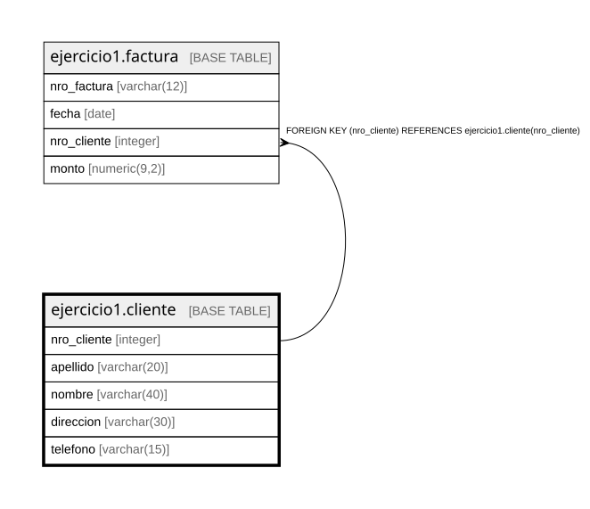

# ejercicio1.cliente

## Description

## Columns

| Name | Type | Default | Nullable | Children | Parents | Comment |
| ---- | ---- | ------- | -------- | -------- | ------- | ------- |
| nro_cliente | integer |  | false | [ejercicio1.factura](ejercicio1.factura.md) |  |  |
| apellido | varchar(20) |  | false |  |  |  |
| nombre | varchar(40) | NULL::character varying | true |  |  |  |
| direccion | varchar(30) | NULL::character varying | true |  |  |  |
| telefono | varchar(15) | NULL::character varying | true |  |  |  |

## Constraints

| Name | Type | Definition |
| ---- | ---- | ---------- |
| cliente_apellido_not_null | n | NOT NULL apellido |
| cliente_nro_cliente_not_null | n | NOT NULL nro_cliente |
| cliente_pkey | PRIMARY KEY | PRIMARY KEY (nro_cliente) |

## Indexes

| Name | Definition |
| ---- | ---------- |
| cliente_pkey | CREATE UNIQUE INDEX cliente_pkey ON ejercicio1.cliente USING btree (nro_cliente) |

## Relations

---

> Generated by [tbls](https://github.com/k1LoW/tbls)
