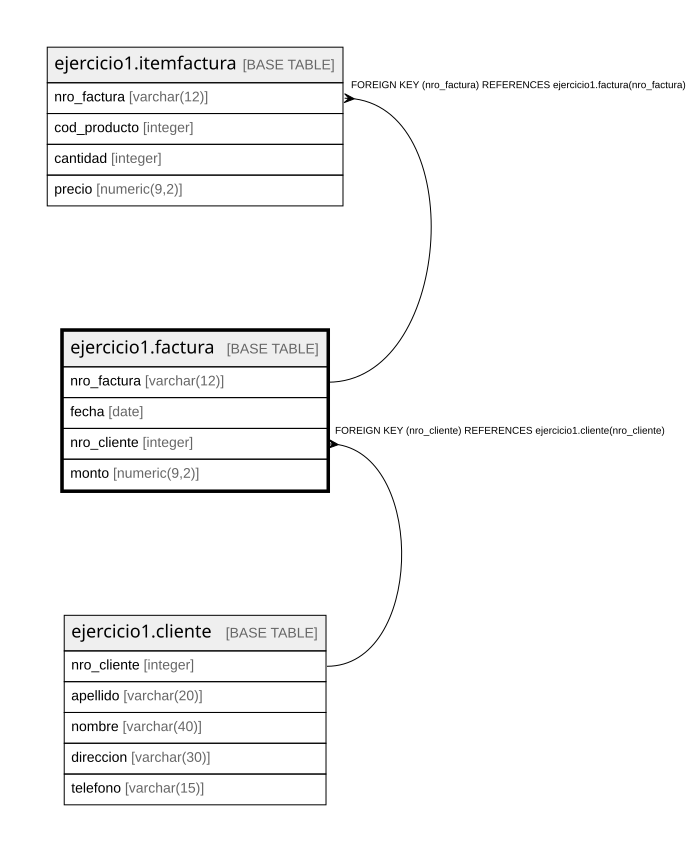

# ejercicio1.factura

## Description

## Columns

| Name | Type | Default | Nullable | Children | Parents | Comment |
| ---- | ---- | ------- | -------- | -------- | ------- | ------- |
| nro_factura | varchar(12) |  | false | [ejercicio1.itemfactura](ejercicio1.itemfactura.md) |  |  |
| fecha | date |  | false |  |  |  |
| nro_cliente | integer |  | false |  | [ejercicio1.cliente](ejercicio1.cliente.md) |  |
| monto | numeric(9,2) | NULL::numeric | true |  |  |  |

## Constraints

| Name | Type | Definition |
| ---- | ---- | ---------- |
| factura_fecha_not_null | n | NOT NULL fecha |
| factura_nro_cliente_not_null | n | NOT NULL nro_cliente |
| factura_nro_factura_not_null | n | NOT NULL nro_factura |
| fk_factura_1 | FOREIGN KEY | FOREIGN KEY (nro_cliente) REFERENCES ejercicio1.cliente(nro_cliente) |
| factura_pkey | PRIMARY KEY | PRIMARY KEY (nro_factura) |

## Indexes

| Name | Definition |
| ---- | ---------- |
| factura_pkey | CREATE UNIQUE INDEX factura_pkey ON ejercicio1.factura USING btree (nro_factura) |

## Relations

---

> Generated by [tbls](https://github.com/k1LoW/tbls)
