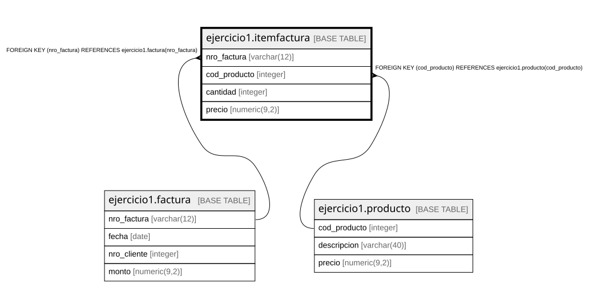

# ejercicio1.itemfactura

## Description

## Columns

| Name | Type | Default | Nullable | Children | Parents | Comment |
| ---- | ---- | ------- | -------- | -------- | ------- | ------- |
| nro_factura | varchar(12) |  | false |  | [ejercicio1.factura](ejercicio1.factura.md) |  |
| cod_producto | integer |  | false |  | [ejercicio1.producto](ejercicio1.producto.md) |  |
| cantidad | integer |  | false |  |  |  |
| precio | numeric(9,2) |  | false |  |  |  |

## Constraints

| Name | Type | Definition |
| ---- | ---- | ---------- |
| itemfactura_cantidad_not_null | n | NOT NULL cantidad |
| itemfactura_cod_producto_not_null | n | NOT NULL cod_producto |
| itemfactura_nro_factura_not_null | n | NOT NULL nro_factura |
| itemfactura_precio_not_null | n | NOT NULL precio |
| fk_itemfactura_1 | FOREIGN KEY | FOREIGN KEY (cod_producto) REFERENCES ejercicio1.producto(cod_producto) |
| fk_itemfactura_2 | FOREIGN KEY | FOREIGN KEY (nro_factura) REFERENCES ejercicio1.factura(nro_factura) |
| itemfactura_pkey | PRIMARY KEY | PRIMARY KEY (nro_factura, cod_producto) |

## Indexes

| Name | Definition |
| ---- | ---------- |
| itemfactura_pkey | CREATE UNIQUE INDEX itemfactura_pkey ON ejercicio1.itemfactura USING btree (nro_factura, cod_producto) |

## Relations

---

> Generated by [tbls](https://github.com/k1LoW/tbls)
