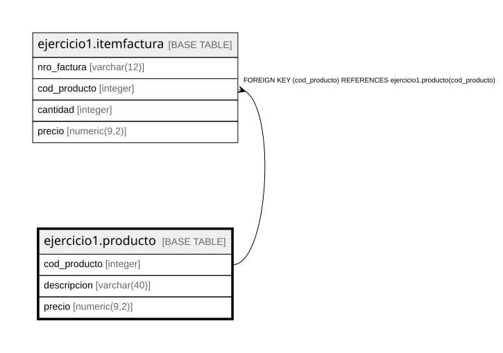

# ejercicio1.producto

## Description

## Columns

| Name | Type | Default | Nullable | Children | Parents | Comment |
| ---- | ---- | ------- | -------- | -------- | ------- | ------- |
| cod_producto | integer |  | false | [ejercicio1.itemfactura](ejercicio1.itemfactura.md) |  |  |
| descripcion | varchar(40) | NULL::character varying | true |  |  |  |
| precio | numeric(9,2) | NULL::numeric | true |  |  |  |

## Constraints

| Name | Type | Definition |
| ---- | ---- | ---------- |
| producto_cod_producto_not_null | n | NOT NULL cod_producto |
| producto_pkey | PRIMARY KEY | PRIMARY KEY (cod_producto) |

## Indexes

| Name | Definition |
| ---- | ---------- |
| producto_pkey | CREATE UNIQUE INDEX producto_pkey ON ejercicio1.producto USING btree (cod_producto) |

## Relations

---

> Generated by [tbls](https://github.com/k1LoW/tbls)
