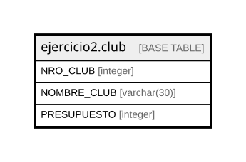

# ejercicio2.club

## Description

## Columns

| Name | Type | Default | Nullable | Children | Parents | Comment |
| ---- | ---- | ------- | -------- | -------- | ------- | ------- |
| NRO_CLUB | integer |  | false |  |  |  |
| NOMBRE_CLUB | varchar(30) |  | false |  |  |  |
| PRESUPUESTO | integer |  | true |  |  |  |

## Constraints

| Name | Type | Definition |
| ---- | ---- | ---------- |
| club_NOMBRE_CLUB_not_null | n | NOT NULL "NOMBRE_CLUB" |
| club_NRO_CLUB_not_null | n | NOT NULL "NRO_CLUB" |

## Relations

---

> Generated by [tbls](https://github.com/k1LoW/tbls)
