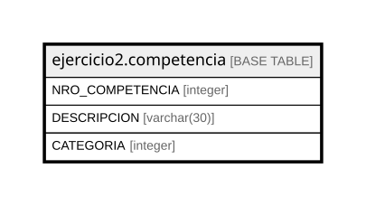

# ejercicio2.competencia

## Description

## Columns

| Name | Type | Default | Nullable | Children | Parents | Comment |
| ---- | ---- | ------- | -------- | -------- | ------- | ------- |
| NRO_COMPETENCIA | integer |  | false |  |  |  |
| DESCRIPCION | varchar(30) |  | false |  |  |  |
| CATEGORIA | integer |  | false |  |  |  |

## Constraints

| Name | Type | Definition |
| ---- | ---- | ---------- |
| competencia_CATEGORIA_not_null | n | NOT NULL "CATEGORIA" |
| competencia_DESCRIPCION_not_null | n | NOT NULL "DESCRIPCION" |
| competencia_NRO_COMPETENCIA_not_null | n | NOT NULL "NRO_COMPETENCIA" |

## Relations

---

> Generated by [tbls](https://github.com/k1LoW/tbls)
