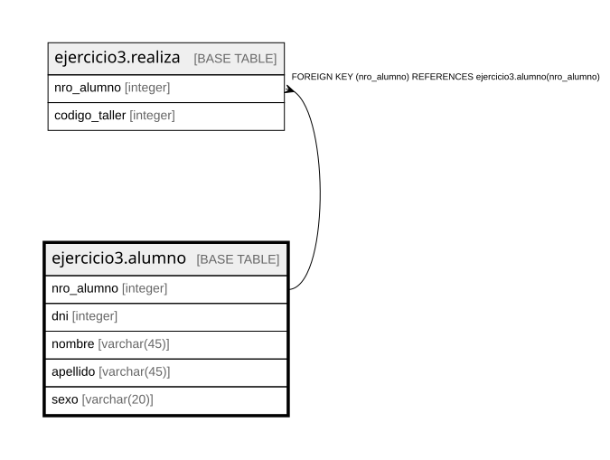

# ejercicio3.alumno

## Description

## Columns

| Name | Type | Default | Nullable | Children | Parents | Comment |
| ---- | ---- | ------- | -------- | -------- | ------- | ------- |
| nro_alumno | integer |  | false | [ejercicio3.realiza](ejercicio3.realiza.md) |  |  |
| dni | integer |  | false |  |  |  |
| nombre | varchar(45) |  | false |  |  |  |
| apellido | varchar(45) |  | false |  |  |  |
| sexo | varchar(20) |  | false |  |  |  |

## Constraints

| Name | Type | Definition |
| ---- | ---- | ---------- |
| alumno_apellido_not_null | n | NOT NULL apellido |
| alumno_dni_not_null | n | NOT NULL dni |
| alumno_nombre_not_null | n | NOT NULL nombre |
| alumno_nro_alumno_not_null | n | NOT NULL nro_alumno |
| alumno_sexo_not_null | n | NOT NULL sexo |
| alumno_pkey | PRIMARY KEY | PRIMARY KEY (nro_alumno) |

## Indexes

| Name | Definition |
| ---- | ---------- |
| alumno_pkey | CREATE UNIQUE INDEX alumno_pkey ON ejercicio3.alumno USING btree (nro_alumno) |

## Relations

---

> Generated by [tbls](https://github.com/k1LoW/tbls)
