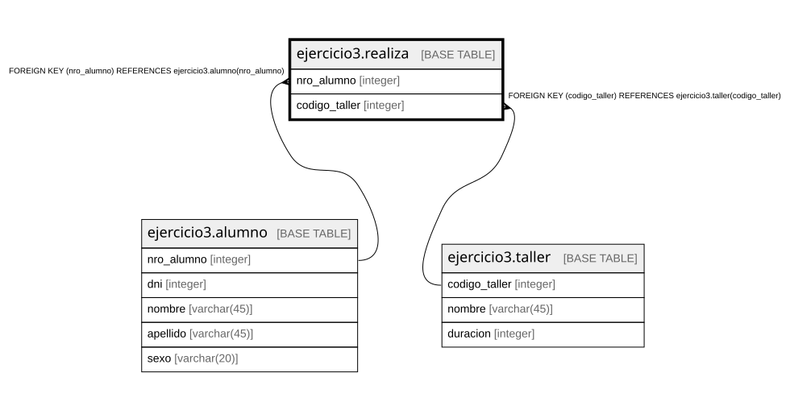

# ejercicio3.realiza

## Description

## Columns

| Name | Type | Default | Nullable | Children | Parents | Comment |
| ---- | ---- | ------- | -------- | -------- | ------- | ------- |
| nro_alumno | integer |  | false |  | [ejercicio3.alumno](ejercicio3.alumno.md) |  |
| codigo_taller | integer |  | false |  | [ejercicio3.taller](ejercicio3.taller.md) |  |

## Constraints

| Name | Type | Definition |
| ---- | ---- | ---------- |
| realiza_codigo_taller_not_null | n | NOT NULL codigo_taller |
| realiza_nro_alumno_not_null | n | NOT NULL nro_alumno |
| fk_realiza_nro_alumno | FOREIGN KEY | FOREIGN KEY (nro_alumno) REFERENCES ejercicio3.alumno(nro_alumno) |
| fk_realiza_codigo_taller | FOREIGN KEY | FOREIGN KEY (codigo_taller) REFERENCES ejercicio3.taller(codigo_taller) |
| realiza_pkey | PRIMARY KEY | PRIMARY KEY (nro_alumno, codigo_taller) |

## Indexes

| Name | Definition |
| ---- | ---------- |
| realiza_pkey | CREATE UNIQUE INDEX realiza_pkey ON ejercicio3.realiza USING btree (nro_alumno, codigo_taller) |

## Relations

---

> Generated by [tbls](https://github.com/k1LoW/tbls)
