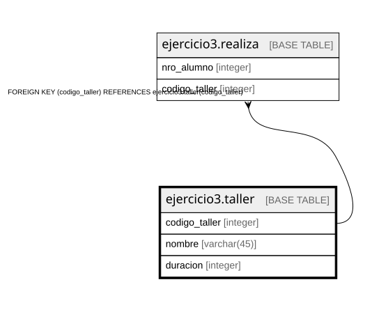

# ejercicio3.taller

## Description

## Columns

| Name | Type | Default | Nullable | Children | Parents | Comment |
| ---- | ---- | ------- | -------- | -------- | ------- | ------- |
| codigo_taller | integer |  | false | [ejercicio3.realiza](ejercicio3.realiza.md) |  |  |
| nombre | varchar(45) |  | false |  |  |  |
| duracion | integer |  | false |  |  |  |

## Constraints

| Name | Type | Definition |
| ---- | ---- | ---------- |
| taller_codigo_taller_not_null | n | NOT NULL codigo_taller |
| taller_duracion_not_null | n | NOT NULL duracion |
| taller_nombre_not_null | n | NOT NULL nombre |
| taller_pkey | PRIMARY KEY | PRIMARY KEY (codigo_taller) |

## Indexes

| Name | Definition |
| ---- | ---------- |
| taller_pkey | CREATE UNIQUE INDEX taller_pkey ON ejercicio3.taller USING btree (codigo_taller) |

## Relations

---

> Generated by [tbls](https://github.com/k1LoW/tbls)
