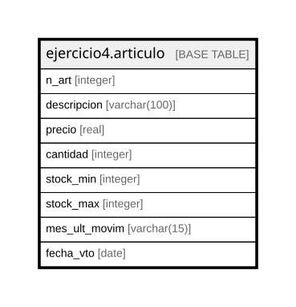

# ejercicio4.articulo

## Description

## Columns

| Name | Type | Default | Nullable | Children | Parents | Comment |
| ---- | ---- | ------- | -------- | -------- | ------- | ------- |
| n_art | integer |  | false |  |  |  |
| descripcion | varchar(100) |  | false |  |  |  |
| precio | real |  | false |  |  |  |
| cantidad | integer |  | false |  |  |  |
| stock_min | integer |  | true |  |  |  |
| stock_max | integer |  | true |  |  |  |
| mes_ult_movim | varchar(15) |  | true |  |  |  |
| fecha_vto | date |  | true |  |  |  |

## Constraints

| Name | Type | Definition |
| ---- | ---- | ---------- |
| articulo_cantidad_not_null | n | NOT NULL cantidad |
| articulo_descripcion_not_null | n | NOT NULL descripcion |
| articulo_n_art_not_null | n | NOT NULL n_art |
| articulo_precio_not_null | n | NOT NULL precio |
| stock_min_max | CHECK | CHECK ((stock_min < stock_max)) |
| valid_price | CHECK | CHECK (((precio > (0)::double precision) AND (precio < (9999)::double precision))) |
| articulo_pkey | PRIMARY KEY | PRIMARY KEY (n_art) |

## Indexes

| Name | Definition |
| ---- | ---------- |
| articulo_pkey | CREATE UNIQUE INDEX articulo_pkey ON ejercicio4.articulo USING btree (n_art) |

## Relations

---

> Generated by [tbls](https://github.com/k1LoW/tbls)
