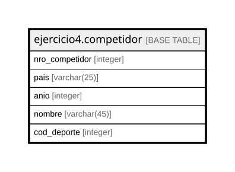

# ejercicio4.competidor

## Description

## Columns

| Name | Type | Default | Nullable | Children | Parents | Comment |
| ---- | ---- | ------- | -------- | -------- | ------- | ------- |
| nro_competidor | integer |  | false |  |  |  |
| pais | varchar(25) | ''::character varying | false |  |  |  |
| anio | integer |  | false |  |  |  |
| nombre | varchar(45) | ''::character varying | false |  |  |  |
| cod_deporte | integer |  | false |  |  |  |

## Constraints

| Name | Type | Definition |
| ---- | ---- | ---------- |
| competidor_anio_not_null | n | NOT NULL anio |
| competidor_cod_deporte_not_null | n | NOT NULL cod_deporte |
| competidor_nombre_not_null | n | NOT NULL nombre |
| competidor_nro_competidor_not_null | n | NOT NULL nro_competidor |
| competidor_pais_not_null | n | NOT NULL pais |
| competidor_pkey | PRIMARY KEY | PRIMARY KEY (nro_competidor) |

## Indexes

| Name | Definition |
| ---- | ---------- |
| competidor_pkey | CREATE UNIQUE INDEX competidor_pkey ON ejercicio4.competidor USING btree (nro_competidor) |

## Relations

---

> Generated by [tbls](https://github.com/k1LoW/tbls)
