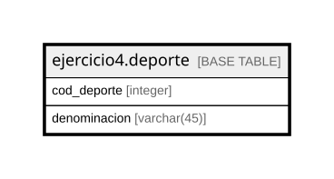

# ejercicio4.deporte

## Description

## Columns

| Name | Type | Default | Nullable | Children | Parents | Comment |
| ---- | ---- | ------- | -------- | -------- | ------- | ------- |
| cod_deporte | integer |  | false |  |  |  |
| denominacion | varchar(45) | ''::character varying | false |  |  |  |

## Constraints

| Name | Type | Definition |
| ---- | ---- | ---------- |
| deporte_cod_deporte_not_null | n | NOT NULL cod_deporte |
| deporte_denominacion_not_null | n | NOT NULL denominacion |
| deporte_pkey | PRIMARY KEY | PRIMARY KEY (cod_deporte) |

## Indexes

| Name | Definition |
| ---- | ---------- |
| deporte_pkey | CREATE UNIQUE INDEX deporte_pkey ON ejercicio4.deporte USING btree (cod_deporte) |

## Relations

---

> Generated by [tbls](https://github.com/k1LoW/tbls)
