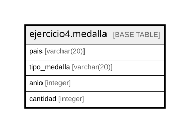

# ejercicio4.medalla

## Description

## Columns

| Name | Type | Default | Nullable | Children | Parents | Comment |
| ---- | ---- | ------- | -------- | -------- | ------- | ------- |
| pais | varchar(20) | ''::character varying | false |  |  |  |
| tipo_medalla | varchar(20) | ''::character varying | false |  |  |  |
| anio | integer |  | false |  |  |  |
| cantidad | integer |  | false |  |  |  |

## Constraints

| Name | Type | Definition |
| ---- | ---- | ---------- |
| medalla_anio_not_null | n | NOT NULL anio |
| medalla_cantidad_not_null | n | NOT NULL cantidad |
| medalla_pais_not_null | n | NOT NULL pais |
| medalla_tipo_medalla_not_null | n | NOT NULL tipo_medalla |
| medalla_pkey | PRIMARY KEY | PRIMARY KEY (pais, tipo_medalla, anio) |

## Indexes

| Name | Definition |
| ---- | ---------- |
| medalla_pkey | CREATE UNIQUE INDEX medalla_pkey ON ejercicio4.medalla USING btree (pais, tipo_medalla, anio) |

## Relations

---

> Generated by [tbls](https://github.com/k1LoW/tbls)
